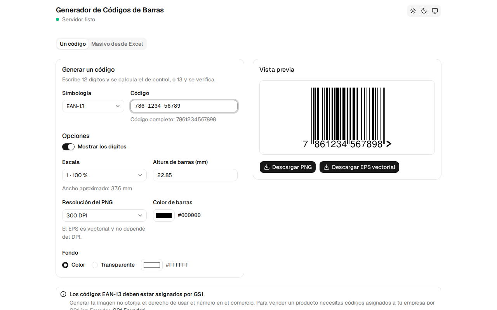
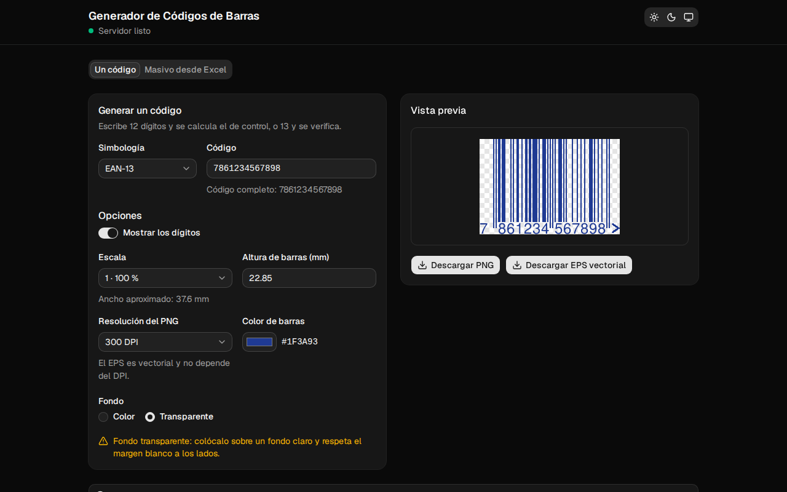
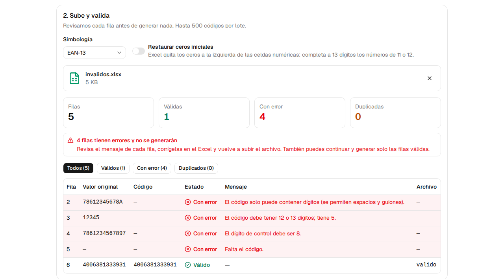
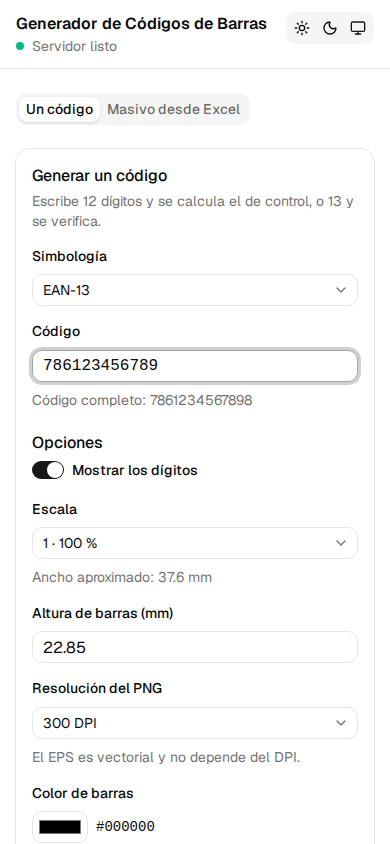

# Generador de Códigos de Barras

Aplicación web para generar códigos de barras **EAN-13** listos para imprenta, en **PNG** y **EPS vectorial**, de a uno o en lote desde Excel. Usa el motor open source [BWIPP](https://bwipp.terryburton.co.uk/) (Barcode Writer in Pure PostScript) con Ghostscript.

- **App:** https://barcode-generator-vert.vercel.app
- **API:** https://barcode-generator-api-yti8.onrender.com (documentación en [`/docs`](https://barcode-generator-api-yti8.onrender.com/docs))

> ⚠️ Generar la imagen no otorga el derecho de usar el número en el comercio. Los códigos EAN-13 deben estar asignados por GS1 (en Ecuador, GS1 Ecuador).

| Un código, con vista previa | Colores y fondo transparente (tema oscuro) |
|---|---|
|  |  |
| **Lote desde Excel: validación por fila** | **Móvil** |
|  |  |

## Funcionalidades

- **Un código:** 12 dígitos (calcula el dígito de control) o 13 (lo verifica), con espacios y guiones ignorados y validación instantánea en el navegador. Vista previa en vivo y descarga en PNG o EPS vectorial.
- **Opciones:** texto legible, escala física (módulo de 0,33 mm × escala; 1 = 100 % GS1), altura real de barras en mm, DPI del PNG, color de barras y fondo (color o transparente) con advertencia de contraste para lectores.
- **Zona de silencio incluida** siempre (11 módulos a la izquierda y 7 a la derecha), para que el código se pueda escanear aunque se coloque al ras de otros elementos.
- **Lote desde Excel:** plantilla descargable, validación previa fila por fila (errores, duplicados, notación científica, ceros iniciales perdidos), y un ZIP con `png/`, `eps/` y `reporte.csv`.
- **EPS vectorial real:** trazos, sin imágenes embebidas, con el texto convertido a contornos (no depende de fuentes instaladas).
- **Pensado para el plan gratuito:** estado del servidor con *warm-up* (Render se duerme), todo en memoria (sin escribir a disco), límites de tamaño y de solicitudes.

## Stack

| Capa | Tecnología |
|---|---|
| Backend | Python 3.12, FastAPI, Pydantic v2, BWIPP (`barcode.ps` de `treepoem`) + Ghostscript, `openpyxl`, `slowapi` |
| Frontend | React 19 + Vite + TypeScript, shadcn/ui (Radix) + Tailwind v4, `react-hook-form` + `zod/mini`, TanStack Query |
| Tipos compartidos | `openapi-typescript` + `openapi-fetch` generados desde el OpenAPI del backend (`pnpm gen:api`) |
| Calidad | ruff, `mypy --strict`, pytest · oxlint, `tsc`, Prettier, Vitest |
| Despliegue | Render (backend, Docker, plan gratuito) · Vercel (frontend) · GitHub Actions |

```
backend/    API FastAPI (uv)
frontend/   React + Vite (pnpm)
docs/       capturas
PLAN.md     requerimientos, arquitectura y fases
```

## Desarrollo local

Hay dos formas de levantar el proyecto: con **Docker** (recomendada, no requiere instalar Python ni Ghostscript) o **sin Docker**, corriendo cada servicio directamente en tu máquina.

### Opción A: Docker (recomendada)

**Requisitos:** [Docker](https://docs.docker.com/get-docker/) con Docker Compose v2 (`docker compose version`).

```bash
git clone https://github.com/JonnathanE/barcode-generator.git
cd barcode-generator
docker compose up --build
```

La primera vez tarda unos minutos (descarga imágenes, instala Ghostscript y las dependencias). Cuando veas el backend `healthy`, quedan disponibles:

| URL | Qué es |
|---|---|
| http://localhost:8000/docs | Swagger: documentación interactiva para probar la API |
| http://localhost:8000/health | Estado y versión del backend |
| http://localhost:5173 | Frontend (Vite) |

**¿Cuándo usar `--build`?** La primera vez y cada vez que cambien dependencias (`backend/pyproject.toml`, `backend/uv.lock` o `backend/Dockerfile`). Si solo cambias código, basta con `docker compose up`. El frontend instala sus dependencias (`pnpm install`) en cada arranque, así que no necesita reconstruirse: si cambian `frontend/package.json` o `pnpm-lock.yaml` (p. ej., tras un `git pull`), basta con `docker compose restart frontend`.

**Recarga automática:** el código se monta como volumen. Los cambios en `backend/app/` reinician uvicorn en uno o dos segundos y los cambios en `frontend/src/` se ven al instante en el navegador.

**Comandos útiles:**

```bash
docker compose up -d --build        # levantar en segundo plano
docker compose ps                   # estado de los servicios
docker compose logs -f backend      # logs JSON del backend en vivo
docker compose restart backend      # reiniciar (p. ej., tras editar backend/.env)
docker compose exec backend gs --version   # comando dentro del contenedor
docker compose down                 # apagar todo
docker compose down -v              # apagar y borrar el volumen de node_modules
```

#### Probar la API desde Swagger

1. Abre http://localhost:8000/docs.
2. Despliega `POST /api/v1/barcodes/{symbology}/render` y pulsa **Try it out**.
3. Escribe `ean13` en `symbology`, elige un ejemplo del cuerpo (o edítalo) y pulsa **Execute**.
4. El PNG se muestra en la respuesta; el EPS aparece como enlace de descarga.

O desde la terminal:

```bash
# Validar (calcula el dígito de control)
curl -X POST localhost:8000/api/v1/barcodes/ean13/validate \
  -H 'Content-Type: application/json' -d '{"code": "786-1234-56789"}'

# Generar un PNG con fondo transparente
curl -X POST localhost:8000/api/v1/barcodes/ean13/render \
  -H 'Content-Type: application/json' -o codigo.png \
  -d '{"code": "786123456789", "format": "png", "options": {"background": "transparent"}}'
```

### Opción B: sin Docker

**Requisitos:**

- [uv](https://docs.astral.sh/uv/getting-started/installation/) (descarga Python 3.12 por su cuenta; no hace falta instalarlo aparte).
- Ghostscript: `sudo apt install ghostscript` (Debian/Ubuntu/WSL) o `brew install ghostscript` (macOS). Verifica con `gs --version`.
- Node.js 24 y pnpm: `corepack enable` (activa la versión fijada en `package.json`) o [instálalo](https://pnpm.io/installation).

**Backend** (terminal 1):

```bash
cd backend
uv sync                                   # crea .venv con dependencias de desarrollo
uv run uvicorn app.main:app --reload      # http://localhost:8000
```

**Frontend** (terminal 2):

```bash
cd frontend
pnpm install
pnpm dev                                  # http://localhost:5173
```

### Variables de entorno

Todas tienen valores por defecto pensados para desarrollo, así que **no es necesario crear archivos `.env`** para empezar. Si quieres cambiar alguna:

```bash
cp backend/.env.example backend/.env       # luego edita los valores
cp frontend/.env.example frontend/.env     # solo para la Opción B
```

| Variable (backend) | Por defecto | Para qué sirve |
|---|---|---|
| `APP_ENV` | `development` | `development`, `test` o `production` (en producción se rechaza `ALLOWED_ORIGINS=*`) |
| `ALLOWED_ORIGINS` | `http://localhost:5173` | Orígenes permitidos por CORS, separados por comas |
| `RATE_LIMIT_SINGLE` | `60/minute` | Límite por IP de `validate` y `render`; súbelo si te bloquea al probar |
| `RATE_LIMIT_BATCH` | `5/minute` | Límite por IP del modo masivo |
| `MAX_UPLOAD_MB` / `MAX_BATCH_ROWS` | `2` / `500` | Límites del modo masivo |
| `GHOSTSCRIPT_TIMEOUT_SECONDS` | `20` | Tiempo máximo por llamada a Ghostscript |
| `LOG_LEVEL` | `INFO` | Nivel de los logs JSON |

En el frontend, `VITE_API_URL` (por defecto `http://localhost:8000`) indica dónde está el backend. Con Docker ya viene configurada en `docker-compose.yml`.

### Tests y calidad

```bash
# Backend dentro del contenedor (no requiere nada instalado localmente)
docker compose exec backend uv run pytest --cov=app

# Backend local (Opción B)
cd backend
uv run pytest --cov=app                   # tests + cobertura
uv run ruff check . && uv run ruff format --check . && uv run mypy app

# Frontend
cd frontend
pnpm lint && pnpm typecheck && pnpm format:check && pnpm test && pnpm build   # lint con oxlint
```

Los tests de generación necesitan Ghostscript; si no está instalado se omiten (aparecen como `skipped`).

Para generar archivos de muestra y medir tiempos: `cd backend && uv run python -m scripts.spike_render` (los deja en `backend/scripts/out/`, ignorado por git).

Los `.xlsx` de prueba del modo masivo están en `backend/tests/fixtures/` (válidos, inválidos, numéricos, notación científica, duplicados, filas vacías, nombres peligrosos, sin columna `codigo`, archivos que no son Excel o tienen macros, y un lote de 500). Se regeneran con `uv run python -m tests.fixtures.build_fixtures`.

### Problemas comunes

| Síntoma | Solución |
|---|---|
| `port is already allocated` al levantar | Otro proceso usa el 8000 o el 5173. Detenlo, o cambia el puerto de la izquierda en `docker-compose.yml` (p. ej., `"8001:8000"`) |
| `ModuleNotFoundError` en el backend tras un `git pull` | Cambiaron dependencias: `docker compose up --build` (o `uv sync` sin Docker) |
| El frontend muestra una página en blanco o errores 500 de Vite tras un `git pull` | Cambiaron dependencias del frontend: `docker compose restart frontend` (o `pnpm install` sin Docker) |
| `Ghostscript (gs) no está instalado` | Opción B sin Ghostscript: instálalo (ver requisitos) |
| `429 RATE_LIMITED` mientras pruebas | Sube `RATE_LIMIT_SINGLE` en `backend/.env` y `docker compose restart backend` |
| El frontend no reacciona a cambios en WSL | Mantén el proyecto dentro del sistema de archivos de Linux (`~/...`), no en `/mnt/c/...` |

## Cómo funciona la generación

El renderer ([`backend/app/services/renderer.py`](backend/app/services/renderer.py)) usa BWIPP en PostScript convertido con Ghostscript, siempre en memoria: entrada por stdin, salida por stdout, `-dSAFER` y timeout. Los datos del usuario viajan codificados en hexadecimal, así no pueden alterar el programa PostScript.

- **Subconjunto de BWIPP:** solo se envían los recursos que necesita la simbología, resueltos con los metadatos `--REQUIRES` (EAN-13: ~56 KB en vez de 1 MB). Interpretar la biblioteca completa costaba ~10 s por llamada con 0,1 CPU.
- **Geometría exacta:** cada simbología declara su extensión en módulos, zona de silencio incluida, y la página de Ghostscript mide exactamente eso. El fondo cubre la zona de silencio y el EPS sale con `%%BoundingBox: 0 0 ancho alto`.
- **EPS:** `ps2write` con `-dNoOutputFonts` (texto en contornos). Como `eps2write` no admite varias páginas por stdout, el documento se separa en un EPS por página con el prolog de `eps2write` (sus dos banderas). Verificado con Ghostscript 10.02, 10.05 y 10.06. Tamaño físico exacto.
- **PNG:** `pnggray` con el módulo ajustado a píxeles enteros e `inkspread` desactivado (con módulos fraccionarios, p. ej. 1,95 px a 150 DPI, las barras salían irregulares y el código no se leía). Con colores personalizados se colorea con Pillow usando la tinta como máscara, así el texto suavizado queda bien sobre cualquier fondo, transparente incluido.
- **Muchos códigos por proceso:** arrancar Ghostscript y cargar BWIPP cuesta ~0,9 s con 0,1 CPU y dibujar un código ~0,1 s, así que `render_many()` genera bloques de 100 códigos por proceso. Un lote de 500 bajó de ~17 minutos a ~36 s en Render.
- **ZIP en memoria:** PNG sin recomprimir (ya están comprimidos) y EPS con deflate nivel 1 (4 veces más rápido, ~20 % más grande). `reporte.csv` con BOM UTF-8 (Excel muestra bien las tildes) y protegido contra inyección de fórmulas.

> ¿Por qué no `treepoem.generate_barcode`? Llama a Ghostscript sin timeout, su `scale` es resolución (no tamaño físico) y devuelve una imagen de Pillow: guardarla como EPS embebe un bitmap. Del paquete solo se usa el `barcode.ps`.

### Excel

El lector ([`excel_reader.py`](backend/app/services/excel_reader.py)) revisa, **antes de abrir el archivo**: tamaño, firma ZIP con `xl/workbook.xml` (rechaza `.xls`, `.docx` o textos renombrados), macros y bombas ZIP (máximo 100 MB descomprimido). Luego lee la primera hoja con `openpyxl` en modo `read_only`, detecta las columnas por encabezado (sin distinguir mayúsculas ni tildes) y normaliza lo que Excel hace con los números: enteros, flotantes, notación científica con dígitos perdidos y ceros iniciales (opción «Restaurar ceros iniciales»).

## API

Documentación interactiva en `/docs` (Swagger). Todos los errores responden `{ "error": { "code", "message", "details" } }`.

| Método | Ruta | Descripción |
|---|---|---|
| GET | `/health` | Estado y versión |
| GET | `/api/v1/symbologies` | Simbologías y formatos disponibles |
| POST | `/api/v1/barcodes/{symbology}/validate` | Normaliza y valida (`{"code": "786-1234-56789"}` → `7861234567898`) |
| POST | `/api/v1/barcodes/{symbology}/render` | PNG o EPS; `?inline=true` para la vista previa |
| GET | `/api/v1/batch/template` | Plantilla `plantilla_codigos.xlsx` |
| POST | `/api/v1/batch/{symbology}/limits` | Máximo de filas y tamaño de PNG para unas opciones |
| POST | `/api/v1/batch/{symbology}/validate` | Paso 1: reporte por fila (multipart: `file`, `restore_leading_zeros`) |
| POST | `/api/v1/batch/{symbology}/generate` | Paso 2: ZIP con `png/`, `eps/` y `reporte.csv` (multipart: `file`, `formats`, `options` en JSON, `restore_leading_zeros`) |

Opciones de `render` (todas opcionales):

| Opción | Valores | Por defecto |
|---|---|---|
| `include_text` | `true` / `false` | `true` |
| `scale` | 1–5 (módulo = 0,33 mm × escala; GS1 admite hasta 2) | `2` (la UI usa 1) |
| `bar_height_mm` | 10–50 (altura final real) | `22.85` |
| `dpi` | 150, 300, 600 (solo PNG) | `300` |
| `bar_color` | `#RRGGBB` (barras y texto) | `#000000` |
| `background` | `#RRGGBB` o `transparent` | `#FFFFFF` |

Los archivos incluyen siempre la zona de silencio de EAN-13 (11 módulos a la izquierda y 7 a la derecha), pintada con el color de fondo.

## Despliegue

### Backend en Render

El servicio se define en [`render.yaml`](render.yaml) (Blueprint): web service Docker gratuito en `virginia`, construido desde `backend/` (stage `runtime` del Dockerfile, usuario sin privilegios), con health check en `/health`.

- **Deploy automático:** cada push a `main` que cambie `backend/**` se despliega **solo si pasa el CI** (`autoDeployTrigger: checksPass`). Si se hacen varios push seguidos y el último no toca `backend/`, Render puede saltear el deploy: en ese caso, `render deploys create srv-db8q8drbc2fs73bq40bg --wait`.
- **Variables:** las de `render.yaml`, más `ALLOWED_ORIGINS`, que se define en el panel de Render (Environment) y nunca en el repo.
- **IP real del cliente:** uvicorn corre con `--proxy-headers`, así el rate limit usa la IP de `X-Forwarded-For` y no la del proxy de Render.

Comandos útiles con el [CLI de Render](https://render.com/docs/cli):

```bash
render services                                       # servicios y URLs
render logs -r srv-db8q8drbc2fs73bq40bg --tail        # logs JSON en vivo
render deploys list srv-db8q8drbc2fs73bq40bg          # historial de deploys
render blueprints validate ./render.yaml              # validar el Blueprint
```

### Frontend en Vercel

- **Proyecto:** importado desde GitHub con *Root Directory* = `frontend`. Vercel detecta Vite y usa el pnpm fijado en `package.json`.
- **Variable:** `VITE_API_URL=https://barcode-generator-api-yti8.onrender.com` (se incrusta en el build: cambiarla requiere redeploy).
- **Cabeceras:** [`frontend/vercel.json`](frontend/vercel.json) define la CSP (su `connect-src` incluye la URL de la API: actualízala si cambia), `nosniff`, políticas de referrer y permisos, y caché inmutable para `/assets/*`.
- **CORS:** el dominio de Vercel está en `ALLOWED_ORIGINS` del backend; si cambia, hay que actualizar esa variable.

### CI y dependencias

- [`backend.yml`](.github/workflows/backend.yml) (cambios en `backend/**`): ruff, `mypy --strict`, pytest con Ghostscript, **cobertura global ≥ 75 % y del dominio ≥ 90 %** (RNF-15; el job falla si baja), `pip-audit` y una prueba de humo de la imagen Docker (`/health` y render PNG/EPS).
- [`frontend.yml`](.github/workflows/frontend.yml) (cambios en `frontend/**`): `pnpm audit --prod`, oxlint, `tsc` (app y tests por separado), Prettier, Vitest y build.
- [Dependabot](.github/dependabot.yml) propone actualizaciones semanales de uv, npm, la imagen Docker (solo dentro de Python 3.12: trae los parches de Debian y Ghostscript) y las GitHub Actions.

## Límites del plan gratuito

| Límite (Render free) | Qué hace la app |
|---|---|
| Se duerme tras 15 min sin tráfico; el cold start medido es de **22,5 s** | Al cargar, el frontend llama a `/health` (timeout de 90 s) y muestra «Iniciando servidor…»; los botones se habilitan cuando responde |
| 0,1 CPU | Subconjunto de BWIPP, varios códigos por proceso de Ghostscript y generación en threadpool |
| 512 MB de RAM | Excel ≤ 2 MB, cuerpos JSON ≤ 64 KB, máximo 500 filas y presupuesto de píxeles para PNG grandes (escala 5 a 600 DPI → 241 filas). Pico medido: 175 MB con 500 filas |
| Disco efímero | Nada se escribe en disco: los archivos subidos se mantienen en memoria y un test lo verifica |
| Servicio público sin autenticación | CORS solo para el dominio de Vercel y rate limit por IP (60/min individual, 5/min lote) |

## Mediciones

Medido el 2026-10-16 en Render (plan gratuito, `virginia`) y Vercel.

| Medición | Resultado |
|---|---|
| Generar un código (servidor, 23 muestras) | mediana **0,74 s** (máx. 1,48 s con escala 5 a 600 DPI) |
| Generar un código visto desde el cliente (Ecuador) | PNG ~1,1 s · EPS ~1,25 s |
| Cold start (`/health` tras 17 min sin tráfico) | **22,5 s**; la UI pasa a «Servidor listo» sola, sin recargar |
| Validar 500 filas | 0,6 s |
| Lote de 50 / 200 / 500 filas, PNG + EPS (escala 1) | 4,8 s / 14,9 s / **36,2 s** (ZIP de 3 / 12 / 30 MB) |
| Lote máximo con PNG grandes (241 filas, escala 5, 600 DPI) | 99,5 s |
| Lighthouse (móvil) en Vercel | **Performance 90–93 · Accesibilidad 100 · Buenas prácticas 100 · SEO 100** |

Todos los lotes quedan dentro del timeout de 180 s del cliente. En Performance, el arreglo con más impacto fue el **layout shift**: el encabezado cambiaba de alto al cargar la fuente web (CLS 0,33 → 0). Le siguió el bundle más chico: `zod/mini` y el modo masivo cargado bajo demanda.

## Seguridad

- **CORS** solo para `ALLOWED_ORIGINS` (la app no arranca con `*` en producción) y **rate limit** por IP real.
- **Entradas:** tamaño de cada cuerpo limitado por `Content-Length` antes de leerlo; el Excel se valida por contenido (sin macros, sin bombas ZIP); nombres de archivo del ZIP sin `/`, `\`, `..` ni nombres reservados de Windows; CSV protegido contra inyección de fórmulas.
- **Ghostscript** con `-dSAFER`, sin archivos y con timeout; los datos del usuario van codificados en hexadecimal.
- **Errores** siempre con el formato `{"error": {...}}`, sin trazas internas. **Logs** JSON con conteos y tiempos, nunca códigos ni contenido de archivos (hay tests que lo comprueban).
- **Cabeceras:** la API envía `nosniff`, `no-referrer`, `X-Frame-Options` y una CSP que lo bloquea todo; el frontend, una CSP que solo permite scripts propios y conexiones a la API.
- **Dependencias:** `pip-audit` y `pnpm audit --prod` en el CI. Riesgo aceptado: `braces` (dependencia de la CLI de shadcn, solo en desarrollo) tiene una vulnerabilidad de denegación de servicio sin versión corregida, que solo aplica a patrones *glob* controlados por un atacante; no llega al navegador.

## Cómo agregar una simbología nueva

La arquitectura está pensada para que una simbología nueva (EAN-8, UPC-A, Code 128, QR…) no requiera cambiar endpoints ni pantallas (RNF-19). Por ejemplo, para EAN-8:

1. **Dominio** (si tiene reglas propias): `backend/app/domain/ean8.py` con su limpieza y dígito de control, y sus tests en `tests/unit/`.
2. **Clase de la simbología:** `backend/app/symbologies/ean8.py` que cumpla el protocolo `Symbology` de [`base.py`](backend/app/symbologies/base.py):
   - `id` (en la URL, p. ej. `"ean8"`), `name` (en la UI), `bwipp_name` (el codificador de BWIPP) y `module_mm`.
   - `supported_formats`: PNG y/o EPS.
   - `normalize(raw)`: valida y devuelve el código o lanza `AppError`.
   - `bwipp_options(options, module_points)`: opciones de BWIPP (texto, altura).
   - `extent(options, module_points)`: área en módulos incluida la zona de silencio. Mídela una vez con `eps2write` (ver [`ean13.py`](backend/app/symbologies/ean13.py)).
3. **Registro:** una línea en [`registry.py`](backend/app/symbologies/registry.py): `registry.register(Ean8())`. El renderer, la API, el modo masivo y `/api/v1/symbologies` ya la incluyen.
4. **Tests:** decodificar los PNG con `zxing-cpp` y verificar que el EPS sea vectorial (copiar los de `tests/integration/test_renderer.py`).
5. **Frontend:** el selector lee `/api/v1/symbologies`, así que la nueva opción aparece sola. Opcionalmente, agrega un validador instantáneo en [`frontend/src/lib/code-validators.ts`](frontend/src/lib/code-validators.ts) (sin él, valida el backend) y regenera los tipos con `pnpm gen:api`.

## Verificación de requisitos

Todos los requisitos de [`PLAN.md`](PLAN.md) quedaron verificados con tests automáticos, en producción o ambos.

<details>
<summary>Requisitos funcionales (RF-01 a RF-23)</summary>

| RF | Requisito | Verificación |
|---|---|---|
| RF-01 | 12 dígitos calculan el dígito de control; 13 lo verifican | `test_ean13_domain.py`, `ean13.test.ts`; producción |
| RF-02 | Rechazo de caracteres, longitud y dígito de control, con el dígito esperado | Tests de dominio y de la API (`INVALID_CHECK_DIGIT` con `expected`) |
| RF-03 | Espacios y guiones ignorados | Tests de dominio en backend y frontend |
| RF-04 | Vista previa PNG con debounce de 300 ms, solo con entrada válida | `SingleBarcodeForm.test.tsx` (una sola petición tras escribir) |
| RF-05 | Texto, escala, altura en mm, DPI y colores | Tests del renderer (tamaño físico, DPI, colores) y del formulario |
| RF-06 / 06a | PNG y EPS vectorial `<codigo13>.ext`; zona de silencio | Tests de la API (`Content-Disposition`) y del renderer (márgenes en blanco) |
| RF-07 | Validación también en el cliente | `ean13.test.ts`, formulario sin llamadas a la API ante errores |
| RF-08 | Plantilla `.xlsx` con columna en formato Texto | `test_template_*`; descarga desde la UI |
| RF-09 | Subida por arrastrar o selector; primera hoja | `BatchPage.test.tsx`; prueba en producción |
| RF-10 | Columnas por encabezado, sin mayúsculas ni tildes | Fixture `encabezado_con_titulo.xlsx` |
| RF-11 | Números, flotantes, notación científica y ceros iniciales | Fixtures `numericos.xlsx` y `cientifica.xlsx` |
| RF-12 | Validación por fila sin generar imágenes | `test_batch_api.py`; validar 500 filas en 0,6 s |
| RF-13 | Tabla con filtros y resumen | `BatchPage.test.tsx`; capturas |
| RF-14 | Formatos, opciones y ZIP solo con filas válidas | Tests de `build_zip` y de la API; descarga real desde Vercel |
| RF-15 | `png/`, `eps/` y `reporte.csv` | `test_batch_zip.py` |
| RF-16 | Nombres de archivo saneados y colisiones `_2`, `_3` | `test_filenames.py`; fixture `nombres_peligrosos.xlsx` |
| RF-17 | Duplicados generados una vez y marcados | Fixture `duplicados.xlsx` |
| RF-18 | Filas vacías ignoradas | Fixture `filas_vacias.xlsx` |
| RF-19 | Rechazo por filas o tamaño, con el límite | Tests de límites (filas, MB, presupuesto de píxeles) |
| RF-20 | Estado del servidor con warm-up | `ServerStatus.test.tsx`; cold start real desde Vercel |
| RF-21 | Aviso de GS1 visible | Siempre visible en la página |
| RF-22 | Interfaz en español | — |
| RF-23 | Selector de simbología | Lee `/api/v1/symbologies` |

</details>

<details>
<summary>Requisitos no funcionales (RNF-01 a RNF-26)</summary>

| RNF | Requisito | Verificación |
|---|---|---|
| RNF-01 | Generación individual < 2 s | Mediana de 0,74 s en Render |
| RNF-02 | Lote de 500 filas medido en Render | 36,2 s (PNG + EPS) |
| RNF-03 | Tamaño máximo validado antes de parsear | `Content-Length` en middleware; tests 413 |
| RNF-04 | Generación en threadpool | `run_in_threadpool` en los endpoints |
| RNF-05 | `openpyxl` en `read_only` y `data_only` | `excel_reader.py` |
| RNF-06 | Timeouts de 90 s y 180 s en el cliente | `client.test.ts`, `client.batch.test.ts` |
| RNF-07 | Sin escritura a disco | Test con *audit hook* (incluida una subida de casi 2 MB) |
| RNF-08 | Flujo masivo stateless | El paso 2 recibe de nuevo el archivo |
| RNF-09 | CORS restringido, nunca `*` en producción | `test_security.py`; producción |
| RNF-10 | Rate limit por IP | `test_security.py`; 429 real con la IP del cliente en Render |
| RNF-11 | Validación por contenido, sin macros | Fixtures `no_es_excel`, `zip_no_excel`, `con_macros` |
| RNF-12 | Nombres saneados | `test_filenames.py`, `test_batch_zip.py` |
| RNF-13 | Sin datos del usuario en logs | `test_logging.py`, `test_batch_api.py` |
| RNF-14 | Errores sin trazas | Tests de `RENDER_FAILED` e `INTERNAL_ERROR` |
| RNF-15 | Cobertura dominio ≥ 90 %, global ≥ 75 % | 100 % y 99 %; el CI falla si baja |
| RNF-16 | PNG decodificables con `zxing-cpp` | Tests del renderer y de cada PNG del ZIP |
| RNF-17 | EPS con cabecera, `BoundingBox` y sin raster | Tests de operadores de página; abierto en Affinity |
| RNF-18 | ruff, `mypy --strict`, oxlint, `tsc`, Prettier | CI |
| RNF-19 | Simbología nueva = una clase registrada | Ver «Cómo agregar una simbología nueva» |
| RNF-20 | Configuración por variables de entorno | `pydantic-settings`; nada sensible en el repo |
| RNF-21 | Responsive desde 360 px | Sin desbordamiento horizontal a 360 px (Playwright) |
| RNF-22 | Accesibilidad | Lighthouse 100; teclado y regiones `aria-live` verificados |
| RNF-23 | Tema claro/oscuro | `ThemeToggle.test.tsx` |
| RNF-24 | Logs JSON estructurados | `test_logging.py` |
| RNF-25 | `/health` liviano | Health check de Render y warm-up del frontend |
| RNF-26 | Deploy automático | Render tras el CI; Vercel en cada push |

</details>

## Estado

**v1.0.0**: Fases 0 a 7 de [`PLAN.md`](PLAN.md) completas. Lo siguiente (Fase 8, solo con aprobación): más simbologías (EAN-8, UPC-A, Code 128, QR, ITF-14, DataMatrix), formatos SVG y PDF, y hojas de etiquetas para imprimir.
